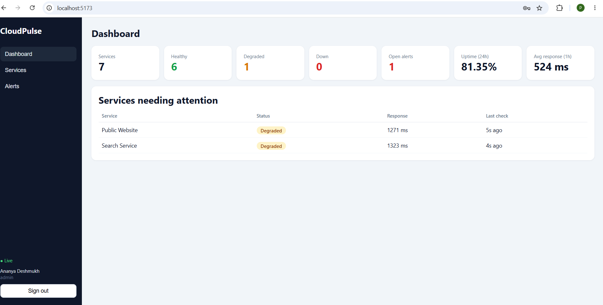
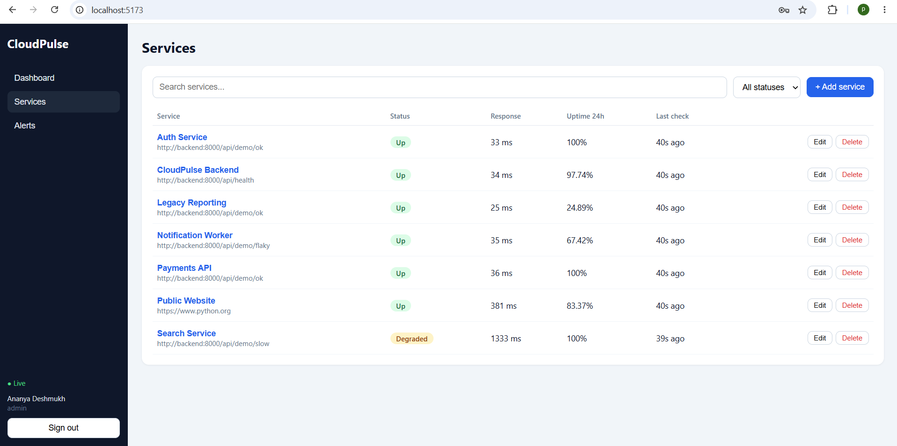
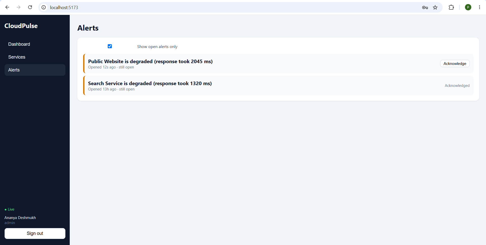

# CloudPulse

> Distributed service monitoring platform for detecting slowdowns, failures, and service recovery in real time.

CloudPulse is a Dockerized full-stack monitoring platform that continuously checks HTTP services, classifies their health, manages alerts, stores monitoring history, and streams live status updates to a React dashboard.

## Why CloudPulse?

Teams often discover outages from users rather than from their own monitoring systems. Manual health checks do not scale, and without historical results it is difficult to understand when a service became unhealthy or recovered.

CloudPulse automates the monitoring lifecycle:

**Schedule checks → Probe services → Classify status → Store results → Manage alerts → Stream live updates**

## Key Features

- Continuous HTTP monitoring using scheduled Celery tasks
- Health classification: `UP`, `DEGRADED`, and `DOWN`
- Failure tolerance: service becomes `DOWN` after 3 consecutive failures
- Alert lifecycle management with escalation and recovery
- Real-time dashboard updates using WebSockets and Redis pub/sub
- Historical monitoring data stored in PostgreSQL
- Redis caching for dashboard statistics
- JWT authentication with admin/viewer roles
- Login rate limiting
- Service search, filtering, pagination, and response-time history
- Docker Compose orchestration
- Interactive FastAPI Swagger documentation

## System Architecture

```text
                    +----------------------+
                    |    React + Vite      |
                    |      Dashboard       |
                    +----------+-----------+
                               |
                         HTTP / WebSocket
                               |
                               v
                    +----------------------+
                    |       FastAPI        |
                    | REST + WebSocket API |
                    +----+------------+----+
                         |            |
                    SQLAlchemy      Redis
                         |        cache/pubsub
                         v            ^
                 +---------------+    |
                 |  PostgreSQL   |    |
                 | users         |    |
                 | services      |    |
                 | checks        |    |
                 | alerts        |    |
                 +---------------+    |
                                      |
                               publish events
                                      ^
                                      |
                 +--------------------+------+
                 |                           |
          +------+-------+            +------+-------+
          | Celery Beat  |            |    Redis     |
          | every 15 sec |----------->| task broker  |
          +--------------+            +------+-------+
                                             |
                                             v
                                    +----------------+
                                    | Celery Worker  |
                                    | async checks   |
                                    +-------+--------+
                                            |
                                       HTTP probes
                                            |
                                            v
                                  +-------------------+
                                  | Monitored Services|
                                  +-------------------+

Monitoring Flow
1. Celery Beat identifies services that are due for a check.
2. Celery workers execute checks asynchronously.
3. The response is evaluated using status code, response time, and consecutive failures.
4. The result is stored in PostgreSQL.
5. CloudPulse calculates the service state.
6. The alert engine opens, escalates, or resolves incidents.
7. Workers publish events through Redis.
8. FastAPI forwards live events through WebSockets to connected dashboards.
Alert Lifecycle
UP
 |
 | slow / failed check
 v
DEGRADED
 |
 | continued failures
 v
DOWN
 |
 | recovery
 v
UP
 |
 +----> active alert resolved

CloudPulse maintains an active incident per service and supports alert escalation from warning to critical instead of creating duplicate active incidents.
Technology Stack
Layer	Technology	Purpose
Frontend	React, Vite	Monitoring dashboard
Backend	FastAPI, Pydantic	REST API and WebSockets
Database	PostgreSQL, SQLAlchemy 2	Monitoring history and application data
Background Processing	Celery	Asynchronous health checks
Scheduler	Celery Beat	Periodic monitoring jobs
Cache / Messaging	Redis	Cache and pub/sub
Authentication	JWT, bcrypt	Authentication and authorization
Infrastructure	Docker Compose	Multi-service deployment
Testing	pytest, unittest	API and monitoring logic


Project Structure
cloudpulse/
├── backend/
│   ├── app/
│   │   ├── main.py
│   │   ├── models.py
│   │   ├── schemas.py
│   │   ├── security.py
│   │   ├── database.py
│   │   ├── redis_client.py
│   │   ├── routers/
│   │   │   ├── auth.py
│   │   │   ├── services.py
│   │   │   ├── alerts.py
│   │   │   ├── dashboard.py
│   │   │   └── demo.py
│   │   ├── services/
│   │   │   ├── monitoring.py
│   │   │   ├── status_logic.py
│   │   │   └── ws_manager.py
│   │   └── tasks/
│   │       ├── celery_app.py
│   │       └── checks.py
│   └── tests/
├── frontend/
│   └── src/
├── docker-compose.yml
├── .env.example
├── .gitignore
├── LICENSE
└── README.md

Database Design
CloudPulse uses four primary entities.
Users
Stores users, roles, password hashes, and account metadata.
Monitored Services
Stores:
- Service name
- Target URL
- Check interval
- Timeout
- Current status
- Consecutive failures
- Last check time
- Last response time
Check Results
Stores each monitoring observation:
- Service
- Timestamp
- Availability
- HTTP status code
- Response time
- Error information
Alerts
Stores monitoring incidents:
- Service
- Severity
- Message
- Creation time
- Acknowledgement state
- Resolution time
API
Interactive API documentation:
http://localhost:8000/docs

Core Endpoints
Method	Endpoint	Purpose
POST	/api/auth/register	Register viewer
POST	/api/auth/login	Authenticate and obtain JWT
GET	/api/auth/me	Current user
GET	/api/services	List/search/filter services
POST	/api/services	Create monitored service
PATCH	/api/services/{service_id}	Update service
DELETE	/api/services/{service_id}	Delete service
GET	/api/services/{service_id}/results	View check history
GET	/api/alerts	View alerts
POST	/api/alerts/{alert_id}/acknowledge	Acknowledge alert
GET	/api/dashboard/summary	Dashboard statistics
GET	/api/health	Backend health
WS	/ws?token=...	Live monitoring events


Demo Monitoring Targets
/api/demo/ok
/api/demo/slow
/api/demo/flaky
/api/demo/down

These endpoints allow the monitoring lifecycle to be demonstrated without external dependencies.
Authentication & Authorization
CloudPulse uses:
- bcrypt password hashing
- signed JWT access tokens
- admin/viewer roles
- login rate limiting
Admins can create, edit, and delete monitored services.

Viewers can view monitoring data and alerts.

Real credentials are supplied through environment variables and are excluded from version control.
Running with Docker
Prerequisites
- Docker Desktop
- Git
1. Clone
git clone https://github.com/prerna354/CloudPulse.git
cd CloudPulse

2. Configure Environment
PowerShell:
Copy-Item .env.example .env

Edit .env and replace the placeholder values with your own secrets.
3. Start CloudPulse
docker compose up --build

The stack includes:
- React frontend
- FastAPI backend
- PostgreSQL
- Redis
- Celery worker
- Celery Beat
4. Open the Application
Dashboard:
http://localhost:5173

API documentation:
http://localhost:8000/docs

Environment Variables
The repository includes a safe environment template:
.env.example

Typical variables:
POSTGRES_PASSWORD=
SECRET_KEY=
SEED_ADMIN_PASSWORD=
SEED_VIEWER_PASSWORD=

Never commit a real .env file or production credentials.
Testing
Run monitoring status tests:
cd backend
python -m unittest tests.test_status_logic -v

Run the complete test suite:
pytest

Demo Scenario
CloudPulse includes built-in endpoints for demonstrating different service conditions.

A slow endpoint can transition:
UP → DEGRADED

A failing endpoint can transition:
UP → DEGRADED → DOWN

After recovery:
DOWN → UP → ALERT RESOLVED

This demonstrates the complete monitoring and alert lifecycle through the dashboard.
## Screenshots

### Dashboard



### Services



### Alerts



Engineering Highlights
CloudPulse demonstrates:
- Asynchronous task execution
- Scheduled background processing
- Distributed worker architecture
- Redis caching and pub/sub
- WebSocket-based real-time communication
- Relational database modeling
- JWT authentication
- Role-based authorization
- Failure-state transitions
- Alert escalation and recovery
- Dockerized multi-service development
- Automated API and logic testing
Future Improvements
- Alembic database migrations
- Email / Slack / webhook notifications
- Per-service alert thresholds
- Configurable retry policies
- Data retention jobs
- Refresh-token authentication
- CI/CD pipeline
- Cloud deployment
- Metrics and distributed tracing
- Multi-tenant monitoring
License
MIT License.

### After pasting

**Don't run Git commands yet.** Just:

1. `Ctrl + A`
2. Paste the entire README above
3. Save with `Ctrl + S`
4. Tell me **“README done”**

Then we'll do the **next step only**: add the actual screenshots to the `docs` folder and make the README look complete on GitHub.